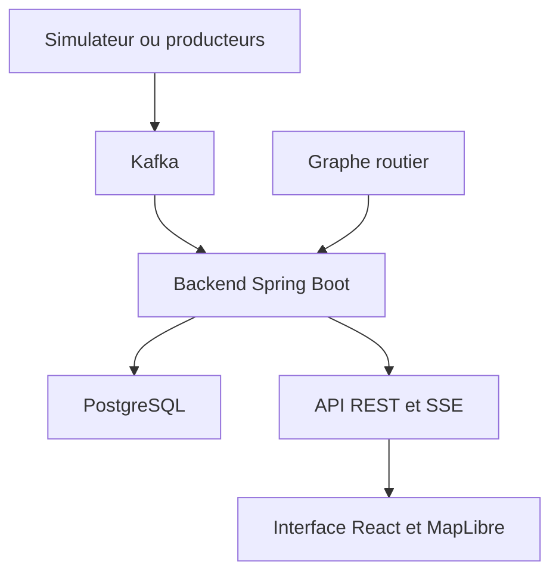

# Architecture et données

Ce guide décrit les composants maintenus du dépôt. Les anciens dossiers de conception, comptes rendus d’incréments et captures de refontes sont consultables dans l’historique Git ; ils ne constituent plus les procédures de mise en service.

## Chaîne de traitement



Le backend est un monolithe modulaire avec un écrivain unique pour l’agrégation. Le navigateur reçoit les agrégats par API et SSE, sans connexion directe à Kafka. Le serveur MCP des anomalies publie les déclarations via la chaîne applicative ; sa configuration est décrite dans [MCP](mcp-anomalies.md).

| Répertoire backend | Rôle |
|---|---|
| `referentiel` | Chargement des gares logiques, résolution des noms et alias |
| `ingestion` | Consommation Kafka, validation, déduplication et quarantaine |
| `aggregation` | Fenêtres, watermark, points de reprise, deltas et compteurs O/D |
| `history` | Persistance et requêtes des agrégats historiques |
| `assignment` | Rattachement au graphe, chemins rapides et charges estimées |
| `diffusion` | Connexions SSE, reprise et contre-pression par client |
| `api`, `security` | REST, administration, session OIDC et contrôle d’accès |

Les frontières de modules sont vérifiées par les tests Spring Modulith. Le [guide CI](ci.md) décrit les contrôles exécutés ; les [protections de performances](performance.md) détaillent les files bornées et les recherches concurrentes.

## Référentiels conservés

| Fichier ou dossier | Usage |
|---|---|
| `gares-peage-2025.csv` | Points de péage source, lus par `scripts/analyse_referentiel.py` |
| `echangeurs-rrnc-2025.csv` | Échangeurs source, utilisés par l’analyse, l’export GeoJSON et la chaîne cartographique |
| `referentiel/gares-logiques-proposition.csv` | Gares logiques proposées par regroupement des points |
| `referentiel/alias-gares.csv` | Correspondance entre noms reçus et identifiants de gares |
| Autres fichiers de `referentiel/` | Liste des gares et cas de regroupement à arbitrer |

Les coordonnées `x`/`y` des CSV sources sont en Lambert-93, EPSG:2154. Les exports cartographiques les reprojettent en WGS84 ; une ligne source de barrière ne correspond pas nécessairement à une gare logique. Les scripts constituent la recette reproductible :

```bash
python scripts/analyse_referentiel.py
python scripts/export_geojson.py
```

Installer au préalable les dépendances de `scripts/requirements.txt`. La CI régénère le référentiel et refuse une dérive par rapport aux fichiers versionnés. Les anciennes copies shapefile et les projets QGIS/ArcGIS ne sont pas utilisés par cette recette et ne sont plus distribués à la racine.

## Événements, temps réel et reprise

Le parseur autorise les champs prévus du contrat, résout les gares et distingue rejets et quarantaine. Les contrats d’anomalies sont décrits dans [Anomalies par gare](anomalies-gares.md). Les points de reprise et les offsets Kafka permettent de reprendre l’agrégation sans recompter les événements déjà traités ; les écritures historiques sont coordonnées avec cette reprise.

Le flux SSE diffuse l’état initial, les deltas et les messages de fraîcheur. L’époque et la séquence permettent au client de détecter un trou ; le tampon de reprise fournit les deltas encore disponibles, sinon une resynchronisation complète est nécessaire. Chaque client possède une file bornée ; la fermeture libère son travailleur. Les historiques persistants ne doivent pas être confondus avec ce tampon de diffusion.

Le mode relecture utilise les séries enregistrées. Les mesures et leurs périodes sont expliquées dans le [guide utilisateur](guide-utilisateur.md), notamment la différence entre débit par minute, cumul journalier et suivi local des anomalies.

## Observations et estimations

Les événements d’entrée et de sortie renseignent les transactions du réseau mesuré. Un flux origine/destination n’est connu que lorsque l’information de rapprochement est disponible. Le réseau gratuit, les positions GPS intermédiaires et la vitesse réelle ne sont pas déduits de ces événements.

L’affectation au trajet le plus rapide et la charge des tronçons sont des **estimations**. Le graphe dérivé d’OpenStreetMap suit les voies retenues par la chaîne ; une gare non rattachée ou un couple sans chemin réduit la couverture. Le seuil de diffusion des petits flux reste appliqué. La validation par des comptages réels reste distincte des essais avec le simulateur.

Le graphe dérivé d’OSM et ses attributions relèvent de l’ODbL ; conserver les attributions des sources lors de leur redistribution. La provenance des concessions et ses limites sont décrites dans [Concessions](concessions.md). Les archives PMTiles, le graphe, les polices, les sprites et leur manifeste sont produits ensemble puis vérifiés avant inclusion dans les images de production.

## Exploitation et limites

La pile utilise actuellement une instance active du backend. Les sessions et budgets par instance nécessiteraient une adaptation pour plusieurs répliques. Le profil Keycloak fourni vise le développement : HTTPS, base externe et gestion des secrets relèvent d’un déploiement de production. La déconnexion applicative n’implique pas nécessairement la fermeture de la session Keycloak.

Pour les procédures actuelles : [Docker](docker.md), [installation des itinéraires](docker.md#flux-suivant-les-routes), [mesure des performances](performance.md) et [vérifications CI](ci.md). Aucune ancienne mesure de développement ne garantit une capacité matérielle ou un nombre d’images par seconde en production.
