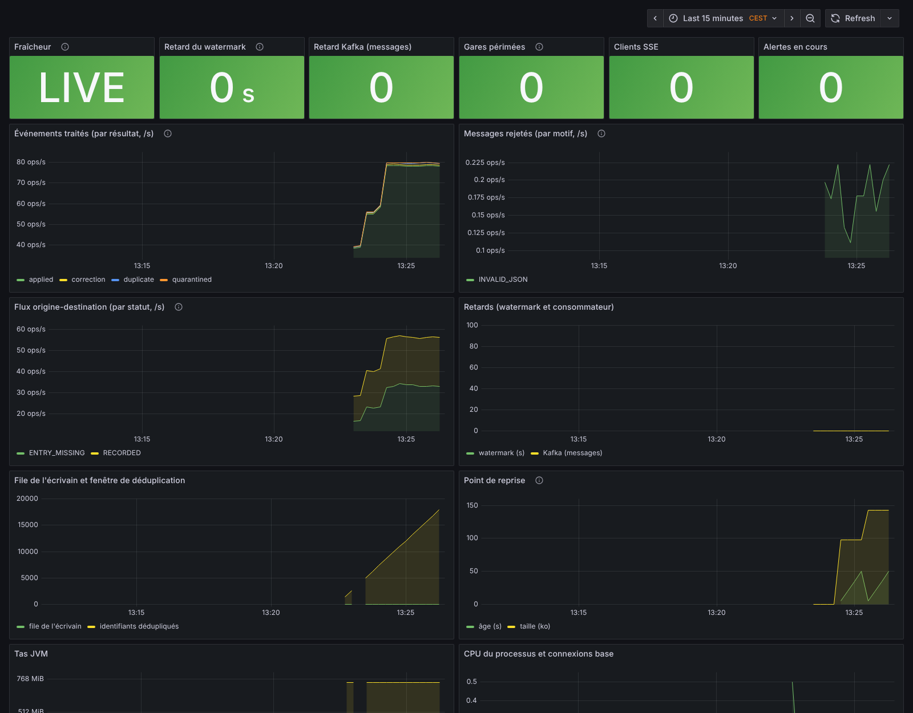

# Docker Compose

Un seul fichier, `compose.yaml`, décrit toute la pile. Les profils choisissent ce qui démarre.

## Démarrage rapide

Sous Windows, depuis PowerShell (Docker Desktop démarré) :

```powershell
.\start.ps1 -Monitoring -Build             # première construction ou code modifié
.\start.ps1 -Monitoring                    # lancement courant, sans reconstruction forcée
.\start.ps1 -Monitoring -CheckOnly         # diagnostic seul, sans changement
.\start.ps1 -Mode demo -Build              # interface et simulation dans le navigateur
.\start.ps1 -Auth -Monitoring -Build       # pile complète + connexion Keycloak
```

Le lanceur crée `.env` uniquement s'il est absent, vérifie le moteur Docker, la configuration et les ports,
attend les sondes avec `up -d --wait`, puis affiche les URL selon les ports configurés. Il choisit explicitement
les profils de cette invocation (les options de `.env` ne s'y ajoutent pas) et refuse un conflit avec un autre
service, y compris un frontend `demo` déjà actif sur le port du mode `full`. Arrêter ce frontend avant de changer
de mode. `-Auth` active à la fois le profil Compose et le profil Spring, sans modifier `.env`.

Si Compose échoue, le lanceur contrôle aussi les services qui viennent de démarrer : un ancien mot de passe
persisté est ainsi signalé avec sa procédure de récupération avant le résumé de l'échec Compose.

`-CheckOnly` n'initialise aucun volume, ne crée pas `.env` et ne modifie aucun service ou secret. Il vérifie les
identifiants PostgreSQL/Grafana si ces services tournent déjà ; sur une pile arrêtée, ces secrets ne peuvent pas
être vérifiés avant son démarrage. `-WaitTimeout 360` ajuste l'attente (240 secondes par défaut).

Sans fond de carte, utiliser `-WithoutBasemap -Build` (mode `full`) : les gares restent visibles sur un fond neutre.
Pour activer les tronçons estimés avec un graphe existant, ajouter par exemple
`-GraphFile cartographie/out/graph/graph-20261024.json`. Le lanceur valide le chemin et ne sélectionne jamais
silencieusement un graphe. Ces options s'appliquent à l'invocation, sans réécrire `.env` ; les répéter au lancement
suivant ou enregistrer les réglages correspondants dans `.env`.

Le lancement direct par Compose reste disponible :

```bash
cp .env.example .env                    # secrets locaux ; COMPOSE_PROFILES=full par défaut
docker compose up -d --build            # simulateur → Kafka → backend → SSE → frontend
# → http://localhost:8080
```

Avec la supervision (Prometheus, Alertmanager et Grafana) : mettre `COMPOSE_PROFILES=full,monitoring` dans `.env`, ou passer
`--profile full --profile monitoring`. Grafana : http://localhost:3000 (utilisateur `admin`, mot de passe `GRAFANA_PASSWORD`) ; Alertmanager : http://localhost:9093.



*Tableau de bord provisionné, sur la pile en fonctionnement avec le simulateur (80 événements par seconde).*

## Profils

| Profil | Services | Usage |
|---|---|---|
| `full` | `simulator`, `kafka`, `kafka-init`, `postgres`, `backend`, `frontend-live` | Pile applicative complète. Les événements sont **simulés** (marqués `simulated: true`) |
| `monitoring` | `prometheus`, `alertmanager`, `grafana` | Métriques, 14 alertes acheminées, tableau de bord. À combiner avec `full` |
| `auth` | `keycloak` | Keycloak (OIDC) de développement, royaume `supervision` importé. Avec `SUPERVISION_PROFILE=auth`, la connexion devient obligatoire pour le backend. À combiner avec `full` |
| `demo` | `frontend` | Interface seule, flux simulé dans le navigateur, sans backend (bandeau « données simulées »). Exclusif avec `full` : même port |
| `infra` | `kafka`, `kafka-init`, `postgres` | Développer le backend ou le simulateur hors conteneur (`localhost:29092`, `localhost:5432`) |
| `tiles` | `tiles` (tâche ponctuelle) | Produire le fond de carte et le graphe routier |

`--profile` sur la ligne de commande **remplace** `COMPOSE_PROFILES` : `docker compose --profile demo up -d` ne démarre que la démonstration.

## Ports

| Port | Service | Exposition |
|---|---|---|
| 8080 | Frontend (nginx : application, tuiles, relais de l'API et du SSE) | `127.0.0.1` |
| 8180 | Keycloak (profil `auth`) | `127.0.0.1` |
| 3000 | Grafana | `127.0.0.1` (`GRAFANA_BIND=0.0.0.0` pour l'ouvrir) |
| 8081 | API du backend, Actuator (`/actuator/health`, `/actuator/prometheus`) | `127.0.0.1` |
| 9090 | Prometheus | `127.0.0.1` |
| 9093 | Alertmanager (profil `monitoring`) | `127.0.0.1` |
| 29092 | Kafka, listener externe | `127.0.0.1` |
| 5432 | PostgreSQL | `127.0.0.1` |

Les ports se changent dans `.env` (`FRONTEND_PORT`, `BACKEND_PORT`, `KAFKA_EXTERNAL_PORT`, `POSTGRES_PORT`, `PROMETHEUS_PORT`, `ALERTMANAGER_PORT`, `GRAFANA_PORT`).
Entre conteneurs, les services se joignent par leur nom (`kafka:9092`, `postgres:5432`, `backend:8080`).

Pour partager explicitement le frontend sur le réseau, définir `FRONTEND_BIND=0.0.0.0`, activer l'authentification
et configurer les URL publiques pour l'adresse réellement utilisée. Le défaut local s'applique aux deux modes
`full` et `demo`. Un ancien conteneur publié sur toutes les interfaces est recréé avec cette liaison au prochain `up`.

## Configuration (`.env`)

| Variable | Rôle | Défaut |
|---|---|---|
| `COMPOSE_PROFILES` | Profils démarrés par `docker compose up` | `full` |
| `POSTGRES_PASSWORD` | Mot de passe PostgreSQL | `changez-moi` |
| `GRAFANA_PASSWORD` | Mot de passe de `admin` dans Grafana | `changez-moi` |
| `FRONTEND_BIND` | Adresse d'écoute du frontend ; `0.0.0.0` pour un partage réseau explicite | `127.0.0.1` |
| `SIMULATOR_RATE` | Événements simulés par seconde | `80` |
| `VITE_BASEMAP_URL`, `VITE_MOTORWAYS_URL`, `VITE_GLYPHS_URL`, `VITE_SPRITE_URL` | Ressources cartographiques, **intégrées au frontend à la construction**. Vides = fond neutre sans libellés | tuiles locales (`/tiles/…`) |
| `SUPERVISION_PROFILE` | `auth` : connexion OIDC obligatoire (profil Spring `auth`). Vide : sans authentification | vide |
| `KEYCLOAK_ADMIN_PASSWORD`, `SUPERVISION_CLIENT_SECRET`, `KEYCLOAK_VIEWER_PASSWORD`, `KEYCLOAK_ADMIN_USER_PASSWORD` | Secrets de Keycloak et des utilisateurs de développement `viewer` et `admin` | `changez-moi` |
| `ASSIGNMENT_GRAPH_FILE` | Graphe routier (chemin dans le conteneur, ex. `/app/graph/graph-AAAAMMJJ.json`) : active la charge estimée des tronçons. Vide = inactive | vide |
| `PROTOMAPS_BUILD` (défaut `latest` : le build le plus récent ; ou une date AAAAMMJJ), `TILES_BBOX`, `TILES_MAXZOOM`, `OSM_MODE`, `REGION_JOBS` | Profil `tiles`. `TILES_MAXZOOM` : 12 par défaut (**retenu**, 1,2 Go) ; 14 donne environ 4,9 Go. `OSM_MODE` : `single` (Geofabrik) ou `regions` (22 extraits d'OpenStreetMap France, `REGION_JOBS` téléchargements en parallèle) | voir ci-dessous |
| `ALERTMANAGER_PORT` | Port publié d'Alertmanager (profil `monitoring`) | `9093` |

**Tous les mots de passe ont une valeur de développement par défaut (`changez-moi`)** : un ancien `.env` auquel manque une variable ne bloque plus le démarrage. Conséquence : un secret oublié reste silencieusement `changez-moi`. Hors poste de développement, définir explicitement `POSTGRES_PASSWORD`, `GRAFANA_PASSWORD`, `KEYCLOAK_ADMIN_PASSWORD`, `SUPERVISION_CLIENT_SECRET`, `KEYCLOAK_VIEWER_PASSWORD` et `KEYCLOAK_ADMIN_USER_PASSWORD` (voir `.env.example`), et ne jamais exposer Grafana, Keycloak ou le frontend à un réseau non fiable avec les valeurs par défaut.

## Fond de carte

Sans tuiles, définir les quatre variables `VITE_*` vides dans `.env` (fond neutre). Pour produire le fond (accès Internet requis) :

```bash
# Par défaut, le build Protomaps le plus récent publié ; pour en figer un : echo "PROTOMAPS_BUILD=20261021" >> .env
docker compose --profile tiles run --rm tiles          # écrit cartographie/out/tiles et cartographie/out/basemaps-assets
# retirer les VITE_* vides de .env, puis reconstruire le frontend :
docker compose up -d --build frontend-live
```

**Sans produire soi-même : tuiles générées par la CI.** Le workflow « Tuiles et graphe routier » (`.github/workflows/tuiles.yml`) produit chaque mois (le 3, et à la demande) le fond avec le **dernier build Protomaps disponible**, les tronçons, le graphe et les polices, exécute la chaîne dans l'image `cartographie/Dockerfile` puis `cartographie/verify_tiles.py` (en-têtes PMTiles, zoom, taille, graphe, **au moins 90 % des gares rattachées à moins de 500 m d'un nœud**, polices et sprites complets), et publie une release `tuiles-AAAAMMJJ` (fichiers, `manifest.json` de traçabilité, `SHA256SUMS`). Pour les installer :

```bash
scripts/fetch_tiles.sh                  # la plus récente, dans cartographie/out ; ou : scripts/fetch_tiles.sh tuiles-20261023
```

Lancement à la demande (onglet Actions → « Tuiles et graphe routier » → Run workflow) : `build` (`latest` ou une date), `osm_mode` (`single` ou `regions`), `maxzoom` (12 par défaut : au-delà d'environ 1,9 Go le fichier ne tient plus dans une release, le contrôle le signale), `publish`. Les données dérivées d'OpenStreetMap restent sous ODbL (voir `docs/increment-4.md`).

Le dossier `cartographie/out/` est monté en lecture seule dans nginx : les tuiles sont servies par requêtes HTTP Range, sans serveur de tuiles.

La même tâche produit le **graphe routier** (`cartographie/out/graph/graph-AAAAMMJJ.json`). Pour activer la charge estimée des tronçons, indiquer son chemin dans le conteneur du backend, qui monte `cartographie/out/graph` en lecture seule sur `/app/graph` :

```bash
echo "ASSIGNMENT_GRAPH_FILE=/app/graph/graph-20261022.json" >> .env   # nom du fichier produit
docker compose up -d backend
```

**Réseau d'entreprise qui intercepte le TLS** : la construction de l'image échoue avec `tls: failed to verify certificate: x509: certificate signed by unknown authority` (modules Go de `pmtiles`). Déposer le certificat racine du proxy, en PEM avec l'extension `.crt`, dans `cartographie/ca/` (jamais versionné, voir son `README.md`) puis `docker compose --profile tiles build tiles` : il est installé dans les deux étapes de l'image avant tout téléchargement. Si le proxy est aussi obligatoire pour sortir (pas d'accès direct), passer ses adresses en `--build-arg HTTPS_PROXY=… --build-arg HTTP_PROXY=…` à la construction.

Si Geofabrik n'est pas joignable, `OSM_MODE=regions` télécharge les 22 extraits régionaux d'OpenStreetMap France (`REGION_JOBS` en parallèle), les filtre aux autoroutes puis les supprime. Les polices et sprites viennent de GitHub Pages (`ASSETS_BASE_URL`). Le fond est produit jusqu'à **z12** (1,2 Go), niveau retenu ; `TILES_MAXZOOM=14` donne environ 4,9 Go. Mesures de la première exécution réelle : `docs/increment-4.md`, section 4.

## Images publiées (Docker Hub)

Les images sont publiées par la CI dans **un seul dépôt**, `compagnonsdudev/autoroutes`, une famille de tags par image :

| Image | Tags | Plateformes |
|---|---|---|
| Backend | `backend-<version>` | amd64, arm64 |
| Simulateur | `simulator-<version>` | amd64, arm64 |
| Interface de production (nginx, tuiles par défaut `/tiles/…`) | `frontend-<version>` | amd64, arm64 |
| Interface de démonstration (flux simulé, sans backend) | `frontend-demo-<version>` | amd64, arm64 |
| Chaîne cartographique (tuiles et graphe) | `cartographie-<version>` | amd64 |

`<version>` : `edge` et `sha-<7 caractères>` pour chaque poussée sur `main` ; `1.2.3`, `1.2` et `latest` pour une version.
Exemple : `docker pull compagnonsdudev/autoroutes:backend-latest`.

**Publier une version** : `git tag v1.2.3 && git push origin v1.2.3`. La CI complète s'exécute, puis, seulement si « CI réussie » est verte, le job « Publication Docker Hub » construit et pousse les cinq images. Jamais sur une pull request ni sur une autre branche que `main`.

**Mise en place (une fois)** : créer un jeton d'accès Docker Hub avec écriture sur `compagnonsdudev/autoroutes` (Docker Hub → Account settings → Personal access tokens), puis, dans GitHub → Settings → Secrets and variables → Actions, les secrets `DOCKERHUB_USERNAME` (le compte propriétaire du jeton) et `DOCKERHUB_TOKEN`. Sans eux, le job le signale par un avertissement et ne publie rien (la CI reste verte).

**Utiliser les images publiées** plutôt que les construire :

```bash
docker compose -f compose.yaml -f compose.hub.yaml pull
docker compose -f compose.yaml -f compose.hub.yaml up -d --no-build     # AUTOROUTES_TAG=1.2.3 pour figer une version (défaut : latest)
```

Limite : l'interface publiée embarque les adresses de tuiles par défaut ; pour d'autres adresses `VITE_*`, construire avec `compose.yaml` seul. Les images arm64 sont construites sans émulation pour la partie compilation (jar et fichiers statiques indépendants de l'architecture) ; l'image cartographique reste amd64.

## Durcissement et ressources

- Conteneurs applicatifs (`backend`, `simulator`, `frontend-live`, `frontend`) : système de fichiers racine en **lecture seule** (écritures dans `/tmp`), `no-new-privileges`, utilisateur non root pour le backend et le simulateur.
- Limites de mémoire : backend 1 Go (JVM à 75 %), simulateur 384 Mo, frontend 128 Mo, Kafka 1,5 Go, PostgreSQL 1 Go, Prometheus et Grafana 512 Mo, Alertmanager 128 Mo. Utilisation mesurée avec 80 événements par seconde : backend ≈ 260 Mo, Kafka ≈ 500 Mo, simulateur ≈ 140 Mo, frontend ≈ 8 Mo.
- Journaux `json-file` en rotation (3 fichiers de 10 Mo).
- Ordre de démarrage garanti par `depends_on` + health checks (Kafka, PostgreSQL, backend, Prometheus, Alertmanager, Grafana, frontend).
- Arrêt propre du backend (45 s) : le point de reprise final est écrit avant la sortie.

## Provenance et disponibilité dans l'interface

Le bandeau distingue données simulées, observées, mixtes et provenance non vérifiée. « Temps réel » indique
la fraîcheur du transport, pas l'origine des événements. Les compteurs de provenance sont enregistrés avec
l'historique et le point de reprise ; la migration conserve les anciens chiffres sans leur attribuer une
origine inventée. Une période contenant des données antérieures à cette migration peut donc rester
« source non vérifiée ». Aucun historique existant n'est supprimé ou reclassé.

`GET /api/v1/capabilities` annonce la provenance de la fenêtre courante et l'état des tronçons
(`DISABLED`, `STARTING`, `READY`). L'interface actualise cette information automatiquement. Les séries par gare
ajoutent `nature` et `coverage.status` : `AVAILABLE` signifie que des points existent, sans garantir une période
complète ; `UNAVAILABLE` distingue l'absence de série d'une mesure à zéro. La relecture consulte séparément
`GET /api/v1/history/provenance?from=…&to=…` pour sa période et ses compteurs de début de journée.
La provenance des agrégats O/D SSE reste `UNKNOWN` ; elle n'est plus déclarée systématiquement `OBSERVED`.

## Supervision

- **Prometheus** collecte `backend:8080/actuator/prometheus` toutes les 15 s (conservation 15 jours) et évalue `observability/prometheus/alerts.yml` : backend injoignable, données périmées, retard du watermark, rattrapage Kafka persistant, file de l'écrivain saturée, quarantaine > 1 %, entrée inconnue > 2 % des sorties, origine connue < 90 % ou écart de rapprochement O/D > 0,5 %, messages rejetés, point de reprise en échec ou ancien, tas JVM, clients SSE.
- **Alertmanager** reçoit les alertes de Prometheus (`alerting` dans `prometheus.yml`) : regroupement par alerte, répétition toutes les 4 h (1 h pour `critical`), et `BackendDown` inhibe les autres alertes. **Aucun récepteur externe n'est configuré** : renseigner e-mail, webhook ou chat dans `observability/alertmanager/alertmanager.yml` (récepteur `equipe`), les secrets par `url_file` / `password_file` ; `docker compose restart alertmanager`.
- **Grafana** charge sa source de données et le tableau de bord `observability/grafana/dashboards/supervision.json` par provisioning (non modifiable depuis l'interface). Ce fichier est **généré** : modifier `observability/grafana/build_dashboard.py` puis `python3 observability/grafana/build_dashboard.py`.
- Métriques ajoutées pour l'exploitation : `toll_watermark_lag_seconds`, `toll_consumer_lag`, `toll_freshness_status` (0 LIVE, 1 RATTRAPAGE, 2 PÉRIMÉ), `toll_stations_stale`, `toll_checkpoint_age_seconds`, `toll_checkpoint_bytes`, `toll_events_rejected_total{reason}`, en plus de `toll_events_total{result}`, `toll_od_total{status}`, `toll_od_origin_known_ratio`, `toll_od_reconciliation_gap_ratio`, `toll_writer_queue`, `toll_dedup_entries`, `sse_clients`.
- Vérification automatique : `scripts/verify_observability.py` contrôle les cibles, qu'Alertmanager est joint par Prometheus, les 14 règles et que chaque panneau reçoit des données (exécuté par la CI).

## Données et maintenance

### Secrets déjà persistés

Modifier `.env` ne change pas automatiquement le mot de passe d'une base PostgreSQL déjà initialisée ni celui
de l'administrateur stocké dans Grafana. Les sondes `pg_isready` et `/api/health` peuvent rester vertes alors
que les identifiants applicatifs sont refusés. Le lanceur teste donc une vraie connexion PostgreSQL par TCP
et l'accès authentifié à `/api/user` de Grafana, sans afficher les secrets.

En cas d'échec, retrouver le secret existant et le reporter dans `.env`, puis relancer le lanceur. Si le secret
est perdu, effectuer une récupération administrateur contrôlée après sauvegarde : connexion locale à PostgreSQL
avec `docker compose exec postgres psql -U supervision -d supervision`, puis commande interactive
`\password supervision` ; pour Grafana, utiliser sa procédure de réinitialisation administrateur avec
`docker compose exec grafana grafana cli admin reset-admin-password --help` pour connaître les options de la
version installée. Saisir un nouveau secret uniquement dans une session administrateur maîtrisée, puis l'aligner
dans `.env`. **Le lanceur ne réinitialise aucun mot de passe et ne supprime aucun volume.** Ne pas utiliser
`docker compose down -v` pour résoudre un problème d'identifiants : cette commande supprime les données.

```bash
docker compose ps                                   # état et santé
docker compose logs -f backend                      # journaux
docker compose restart backend                      # redémarrage : reprise depuis le point de reprise, sans double comptage
docker compose down                                 # arrêt, données conservées (volumes kafka-data, postgres-data, …)
docker compose down -v                              # arrêt ET suppression des données
docker compose exec -T postgres pg_dump -U supervision supervision > sauvegarde.sql      # sauvegarde de la base
curl -s localhost:8081/api/v1/diagnostic | python3 -m json.tool                          # retard, quarantaine, rejets
```

Après `down -v`, le backend repart sans point de reprise : il relit Kafka depuis minuit (heure de Paris).

## Limites connues

- Kafka est un nœud unique (KRaft, facteur de réplication 1) et les liaisons sont en clair : adapté au développement et à la démonstration, pas à la production telle quelle.
- **Authentification** : sans `SUPERVISION_PROFILE=auth`, le frontend et l'API sont ouverts à qui joint le port 8080 (démonstration, développement). Avec le profil, la connexion OIDC est obligatoire (voir `docs/increment-5.md`). Grafana n'est joignable que depuis la machine par défaut.
- Alertmanager (port 9093, `ALERTMANAGER_PORT`) regroupe les alertes (4 h de répétition, 1 h pour `critical`) et inhibe les autres alertes quand `BackendDown` est actif ; **aucun récepteur externe n'est configuré** : renseigner e-mail, webhook ou chat dans `observability/alertmanager/alertmanager.yml` (récepteur `equipe`, secrets via `url_file`/`password_file`).
- Les sauvegardes de volumes et la rotation des secrets ne sont pas automatisées.
- **Grafana est sous licence AGPL-3.0** (Prometheus : Apache-2.0). L'usage interne sans modification n'impose rien de particulier ; distribuer une version modifiée ou l'offrir en service à des tiers déclenche des obligations : à valider avec le service juridique avant tout autre usage. Le profil `monitoring` est optionnel.
- La chaîne `tiles` a été exécutée de bout en bout sur l'hôte (voir `docs/increment-4.md`, section 4) ; l'image `cartographie/Dockerfile` **se construit** (vérifié : `pmtiles`, `tippecanoe`, `osmium`) mais son exécution (`docker compose --profile tiles run --rm tiles`) n'a pas été rejouée de bout en bout, et la CI ne la construit pas ; derrière un proxy qui intercepte le TLS, déposer son certificat dans `cartographie/ca/` (voir plus haut), et Docker Hub peut limiter le débit (`GOLANG_IMAGE` / `UBUNTU_IMAGE` pour un miroir). Les sources ont changé selon l'accessibilité : `OSM_MODE=regions` utilise les extraits régionaux d'OpenStreetMap France quand Geofabrik n'est pas joignable.
- Les images sont construites par `docker compose --build` ; dans l'environnement de développement, `docker build` ne pouvait pas télécharger les dépendances (proxy TLS) et les images locales ont été construites à partir des artefacts. La CI exécute le build complet.
